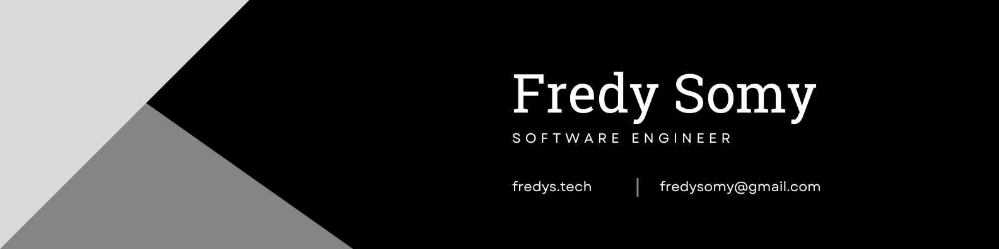

Hi there! I'm **Fredy Somy**, a Software Engineer with **2+ years of experience** building web applications, data platforms, and developer tools. I enjoy solving complex technical problems, scaling production systems, and building reliable software.

I primarily work with **Python and JavaScript**, with experience across **Django, Flask, Vue.js, Nuxt.js, Express.js, Docker, Kubernetes, Redis, Celery, Kafka, and RabbitMQ**. I'm also an Open Source enthusiast and the creator of [PysonDB](https://github.com/pysonDB/pysonDB).

* 👩‍💻 All my Projects [here](https://fredys.tech/#head/)

* 🌐 My Portfolio [here](https://fredys.tech/)

* 📄 My Resume [here](https://drive.google.com/file/d/1p7lwKXgBdNZGmadVQ3lP6Ggb3NV_gPRn/view?usp=sharing)

